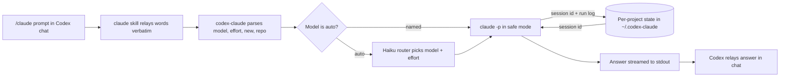

# Claude for Codex

Call Claude models from Codex chat with one command. `/claude` enters Claude
mode: Codex should keep routing your turns to Claude until you say to stop. Say
nothing extra and a conservative router keeps Fable unless a smaller model is
obviously right; name a model to override. Keeps a conversation going across
calls, and reads your repo only when you say so. Uses your existing Claude Code
CLI login — **no API key**.

```text
/claude why would a mutex deadlock here?        ← router picks the model
/claude opus high review my plan                ← or you do
```

## How it works



Codex never answers the question itself: the skill hands your words to the
`codex-claude` wrapper, which picks the model and effort and runs your local
`claude` CLI. The session id is saved per project outside your repo, so the
next call resumes the same Claude conversation.

## Requirements

- Codex CLI or Codex app with plugin support
- [Claude Code CLI](https://claude.com/claude-code) installed and authenticated (`claude --version`)
- Node.js 18+

## Install

```bash
git clone https://github.com/jackieoliver/codex-claude-fable-plugin.git
cd codex-claude-fable-plugin
npm link                                  # provides the codex-claude binary
codex plugin marketplace add "$(pwd)"
```

Open Codex, run `/plugins`, install **Claude for Codex**, and start a new thread.
Type `/claude` to invoke the skill from the slash command menu.

### Staying up to date

- **Developing from this checkout:** wrapper code is live immediately (the
  `codex-claude` binary is npm-linked to the working tree). Only `skills/` and
  the plugin manifest are snapshotted by Codex — refresh with `npm run refresh`,
  or make it automatic on commits that touch them:

```bash
cat > .git/hooks/post-commit << 'EOF'
#!/bin/sh
if git diff HEAD~1 --name-only 2>/dev/null | grep -qE '^(skills/|\.codex-plugin/|\.agents/)'; then
  sh "$(git rev-parse --show-toplevel)/scripts/refresh-plugin.sh" || true
fi
EOF
chmod +x .git/hooks/post-commit
```

- **Installing on another machine from GitHub:** add the repo URL as a git
  marketplace instead, then pull updates with one command:

```bash
codex plugin marketplace add https://github.com/jackieoliver/codex-claude-fable-plugin.git
codex plugin marketplace upgrade    # refresh to latest from GitHub
```

## Usage

```text
/claude <prompt>                     auto: conservative router; fable unless obviously smaller
/claude opus <prompt>                leading word picks the model (no routing)
/claude sonnet low <prompt>          model + effort, any order
/claude repo <prompt>                Claude may read the repo (read-only) this call
/claude new [model] <prompt>         start a fresh conversation
/claude models                       list models/efforts, defaults marked
/claude use opus high                pin defaults (use auto to re-enable routing)
/claude config                       show resolved config + session state
/claude on                           mark Claude mode active
/claude stop                         stop Claude mode; return future turns to Codex
/claude -- <prompt>                  everything after -- is prompt (escape hatch)
```

- **Models:** `auto` (default), `fable`, `opus`, `sonnet`, `haiku` — or any
  `claude-*` model id verbatim.
- **Efforts:** `low`, `medium`, `high`, `xhigh`, `max`.
- `$claude ...` remains the explicit skill-invocation fallback on surfaces
  where Codex doesn't expose skill slash commands.

## Claude mode

`/claude` is intended to be sticky in a Codex thread: after you invoke it once,
Codex should keep sending later turns to Claude until you say to stop, switch
back to Codex, or run `/claude stop`. The wrapper records that intent in
`.codex-claude/config.json` as `stickyMode`; whether future plain messages are
captured automatically depends on the Codex surface honoring the skill's
conversation instruction.

## Auto-routing

With no model word, a fast haiku call reads your prompt, keeps `fable` as the
default, and chooses a smaller model only when that is obvious from the prompt.
Trivial lookups may land on `haiku`, clearly routine work may land on `sonnet`,
and bounded careful analysis may land on `opus`; ambiguous, open-ended,
architectural, or hard reasoning stays on `fable`. When you haven't named an
effort anywhere, the routed model brings a matching one (`haiku → low`,
`sonnet → high`, `opus`/`fable → xhigh`); an effort you name, set in env, or
pin in config always wins. The
decision is echoed as `[claude] auto-router → <model> <effort>` so it's never a
mystery. If routing fails, the call falls back to `fable xhigh`. Naming a model
skips the router entirely.

## Memory

Conversations persist per project: consecutive Claude-mode calls continue one
Claude session (model switches keep the thread). Say `new` to start over.
Session state and run logs live **outside your repo** in
`~/.codex-claude/projects/<project>-<hash>/`, so prompts and session ids can
never be committed by accident; no ids to manage. (State from older versions
in `<repo>/.codex-claude/` migrates automatically on first call.) If a resumed
conversation gets old (>7 days) or long (>50 calls), the wrapper prints a
heads-up suggesting `new`.

## Repo access

By default Claude answers in pure chat mode and cannot see your files. Add the
`repo` keyword to grant **read-only** tools (`Read`, `Grep`, `Glob`) for that
call — never writes, never shell:

```text
/claude opus repo review the error handling in scripts/claude-call.mjs
```

## Isolation

Calls run with Claude's `--safe-mode`, so your local Claude plugins, hooks, and
MCP servers are not loaded. Opt out per call with `--allow-customizations` or
`CODEX_CLAUDE_ALLOW_CUSTOMIZATIONS=1`.

## Defaults and overrides

Resolution order for model and effort:

1. Words in the call (`/claude opus high ...`)
2. `CODEX_CLAUDE_MODEL` / `CODEX_CLAUDE_EFFORT` environment variables
3. `.codex-claude/config.json` (written by `/claude use ...`)
4. Built-ins: `auto` (router) / `xhigh`

## Troubleshooting

- Every call writes a log to `~/.codex-claude/projects/<project>-<hash>/runs/`
  with the prompt, output, and exit code (`/claude config` shows the exact
  `stateDir`).
- Dry-run any call to see the exact `claude` command without running it:

```bash
codex-claude --dry-run "opus high review my plan"
```

- Parser self-test: `npm run smoke`

## Output note

The wrapper streams Claude stdout to the calling process; Codex relays the
final visible answer in chat. Native token streaming inside the Codex assistant
bubble is not guaranteed.

## Experimental: native provider mode

There is a separate, experimental path that registers Claude as a real Codex
model provider (Codex's own `/model` picker, API-key billing). It is **not**
part of this plugin's supported surface — see [docs/native-mode.md](docs/native-mode.md).

## Public safety

This repository contains no API keys, tokens, or local state. `.gitignore`
excludes `.codex-claude/`, `.claude/`, `.codex/`, `.fable/`, `.env*`, logs, and
local overrides.
